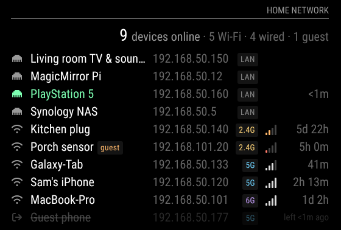

# MMM-AsusDevices

A [MagicMirror²](https://magicmirror.builders) module that shows the devices connected to an **Asuswrt-Merlin** (or stock Asuswrt) router, in real time.

- Live list of online devices: name, IP, wired / 2.4 / 5 / 6 GHz band, signal bars and connection time
- New arrivals are highlighted, and devices that leave stay faded and struck through for a couple of minutes
- Works with AiMesh: the router reports clients on every node
- Two ways to connect: the router's **web API** (default, no extra software) or **SSH**
- Backs off automatically on errors, so a wrong password won't get your router to lock you out
- Several instances can share one mirror (for example one wired-only, one Wi-Fi-only)
- Sends `ASUS_DEVICE_JOINED` / `ASUS_DEVICE_LEFT` notifications that other modules can react to



## Installation

```bash
cd ~/MagicMirror/modules
# copy or unzip the MMM-AsusDevices folder here
```

That's it for the default web-API method: the module has **no dependencies**, so you don't need `npm install`.

If you want `method: "ssh"`, also run:

```bash
cd MMM-AsusDevices
npm run install-ssh   # installs ssh2 and skips its optional native add-on (cpu-features)
```

### Compatibility

| | Works with |
|---|---|
| MagicMirror | 2.10 and newer (tested on 2.10 and 2.38) |
| Node.js, `method: "http"` | 8 and newer (tested on 8, 10, 12 and 22) |
| Node.js, `method: "ssh"` | 10.16 and newer (required by the `ssh2` library) |

On old MagicMirror versions, a syntax error in any module is reported as
*"WARNING! Could not validate config file … Please correct syntax errors at or above this line: …/node_helper.js"*.
That usually means a module needs a newer Node than the one MagicMirror runs on. Check with `node -v`.

Before you edit the mirror config, check that the module can talk to your router:

```bash
ASUS_PASSWORD='your-router-password' node scripts/probe.js --host 192.168.50.1 --user admin
# HTTPS web UI?  add: --protocol https --port 8443
# SSH instead?   node scripts/probe.js --method ssh --host 192.168.50.1 --user admin --key ~/.ssh/id_ed25519
```

If it prints a table of your devices, the module will work with the same settings.

## Configuration

Add this to `config/config.js`:

```js
{
  module: "MMM-AsusDevices",
  position: "top_right",
  header: "Home Network",
  config: {
    host: "192.168.50.1",
    username: "admin",
    password: "${SECRET_ASUS_PASSWORD}",
    deviceNames: {
      "AC:84:C6:11:22:33": "Sam's iPhone"
    }
  }
}
```

### Keep the password out of the browser

From MagicMirror **2.38**, put secrets in `config/config.env`:

```
SECRET_ASUS_PASSWORD=your-router-password
```

Then use `"${SECRET_ASUS_PASSWORD}"` in `config.js`, as shown above. Browsers showing the mirror only ever see `**SECRET_ASUS_PASSWORD**`. MagicMirror substitutes the real value on the server side, where this module logs in. On older MagicMirror versions you can put the password directly in `config.js`, but anyone who can open the mirror's web page can read it.

**Tip:** create a separate, non-admin-looking account if your firmware allows it. Don't reuse the router password anywhere else.

### Options

| Option | Default | Description |
|---|---|---|
| `method` | `"http"` | `"http"` uses the router's web API (the one the ASUS Router app uses). `"ssh"` reads the client list over SSH. |
| `host` | `"192.168.50.1"` | Router IP or hostname (`router.asus.com` works too). |
| `protocol` | `"http"` | `"https"` if *Administration → System → Authentication Method* is HTTPS-only. |
| `port` | `null` | Web UI port. Defaults to `80` for http and `8443` for https (the Merlin default). |
| `rejectUnauthorized` | `false` | Verify the router's TLS certificate. The default certificate is self-signed, so leave this `false` unless you installed a real one. |
| `username` / `password` | `"admin"` / `""` | Router login. |
| `sshPort` | `22` | SSH port (`method: "ssh"`). |
| `privateKey` | `null` | Path to an SSH private key, e.g. `"~/.ssh/id_ed25519"`. Used instead of the password when set. |
| `passphrase` | `null` | Passphrase for `privateKey`. |
| `lanInterface` | `"br0"` | LAN bridge name (`method: "ssh"`). |
| `timeout` | `10000` | Request timeout in ms. |
| `updateInterval` | `10000` | How often to poll the router, in ms. Values of 5000–15000 work well. |
| `departureDelay` | `15000` | How long a device must be missing before it counts as gone. Smooths over Wi-Fi blips. |
| `includeOffline` | `false` | Also list devices the router remembers but reports as offline. |
| `columns` | `["icon","name","ip","band","signal","uptime"]` | Any of `icon`, `name`, `ip`, `mac`, `vendor`, `band`, `signal`, `rate` (Wi-Fi link rate), `node` (AiMesh node), `uptime`. |
| `sortBy` | `"name"` | `name`, `ip`, `connection`, `signal`, `uptime` or `recent` (newest arrivals first). |
| `groupByConnection` | `false` | Split the list into *Wi-Fi* and *Wired* sections. |
| `maxDevices` | `25` | Maximum rows to show (`0` = unlimited). Extra devices are summarised as "+ N more". |
| `showWired` / `showWireless` / `showGuest` | `true` | Filter by connection type. |
| `includeMacs` | `[]` | If set, show only these MACs (e.g. family phones for a "who's home" view). |
| `excludeMacs` | `[]` | Never show these MACs (switches, mesh nodes, IoT clutter). |
| `deviceNames` | `{}` | `{ "MAC": "Friendly name" }`. Overrides names from the router. Upper or lower case, `:` or `-`. |
| `nodeNames` | `{}` | `{ "node MAC": "Upstairs" }` labels for the `node` column. |
| `maxNameLength` | `22` | Truncate long names with "…". |
| `showSummary` | `true` | Show the "12 devices online · 8 Wi-Fi · 4 wired" line. |
| `showSignalDbm` | `false` | Show the RSSI value next to the signal bars. |
| `highlightNew` | `300000` | Highlight devices that joined in the last N ms (`0` turns it off). |
| `showDeparted` | `120000` | Keep departed devices visible, faded, for N ms (`0` turns it off). |
| `hideWhenEmpty` | `false` | Render nothing when no devices match. |
| `scale` | `1` | Size multiplier for the whole module, header included. `1.5` = 50% larger, `0.8` = smaller. |
| `broadcastNotifications` | `true` | Send notifications to other modules (see below). |

### Examples

**Who's home** (phones only, newest arrivals first):

```js
config: {
  host: "192.168.50.1", username: "admin", password: "${SECRET_ASUS_PASSWORD}",
  includeMacs: ["AC:84:C6:11:22:33", "3C:22:FB:77:88:99"],
  deviceNames: { "AC:84:C6:11:22:33": "Sam", "3C:22:FB:77:88:99": "Alex" },
  columns: ["icon", "name", "uptime"],
  showSummary: false,
  sortBy: "recent"
}
```

**Network dashboard** (everything, grouped, with link rates and mesh node):

```js
config: {
  host: "192.168.50.1", username: "admin", password: "${SECRET_ASUS_PASSWORD}",
  groupByConnection: true, maxDevices: 40,
  columns: ["icon", "name", "ip", "band", "signal", "rate", "node", "uptime"],
  nodeNames: { "04:D9:F5:AA:BB:CC": "Main", "10:7B:44:01:02:03": "Upstairs" }
}
```

## Placing it on the right, vertically centred

MagicMirror has no "middle right" position: the middle row only has `middle_center`. Use `position: "middle_center"`
and add this to your custom CSS file. That's `css/custom.css` on older MagicMirror versions and `config/custom.css` on newer ones.
Create the file if it doesn't exist.

```css
/* MMM-AsusDevices: right-hand side, vertically centred */
.region.middle.center .MMM-AsusDevices {
  width: -webkit-fit-content;
  width: fit-content;
  margin-left: auto;   /* push to the right edge */
  text-align: right;
}
```

If you'd rather keep `position: "top_right"`, you can push the module further down the screen instead:
`.region.top.right .MMM-AsusDevices { margin-top: 20vh; }`.

## Notifications for other modules

| Notification | Payload |
|---|---|
| `ASUS_DEVICES` | `{ devices: [...], count, updatedAt }`, sent after every successful poll |
| `ASUS_DEVICE_JOINED` | `{ mac, name, ip, connection, wireless, guest, rssi }` |
| `ASUS_DEVICE_LEFT` | same shape |

For example, another module could play a chime or show an alert when a particular phone arrives home.

## How it works

**`method: "http"`** logs in to `/login.cgi` the way the ASUS Router mobile app does, keeps the session token, and calls `appGet.cgi` with `hook=get_clientlist()` on every poll. This is the same list the router's *Network Map → Clients* page uses, so names you set there are shown here. Because it uses the app's user agent, it doesn't log you out of the router's web UI in your browser. Expired sessions are renewed automatically, and the module logs out cleanly when MagicMirror stops.

**`method: "ssh"`** opens one persistent SSH connection and runs a small read-only shell script each poll. The script reads `/tmp/clientlist.json` (the router's own AiMesh-aware client list), `wl assoclist` / `sta_info` for each radio (band, RSSI, link rate, connection time), the LAN neighbour table, DHCP leases, and your custom client names from nvram. Enable SSH under *Administration → System → Enable SSH: LAN only*. Key-based login is recommended; add your public key on the same page.

| | `http` (default) | `ssh` |
|---|---|---|
| Setup | Nothing extra | Enable SSH, `npm run install-ssh` |
| Data source | Router's Network Map | Router's client list plus the radios directly |
| AiMesh node clients | ✓ | ✓ when `/tmp/clientlist.json` exists, otherwise wired detection is approximate |
| Affected by web UI lockouts / CAPTCHA | Yes | No |

## Troubleshooting

| Message | What to do |
|---|---|
| *Router rejected the username or password* | Check the credentials with `scripts/probe.js`. The module waits 5 minutes before trying again, to avoid triggering the router's lockout. |
| *Router has temporarily locked logins* | Too many failed attempts. The module waits for the lock to expire. |
| *Router is asking for a CAPTCHA* | Log in once in a browser to clear it, or switch to `method: "ssh"`. |
| *Cannot reach router* / timeout | Wrong host or port, or the web UI is HTTPS-only. Try `protocol: "https"` (port 8443). |
| *TLS handshake failed* | You set `protocol: "https"` on the HTTP port, or the other way round. |
| *did not include get_clientlist* | Very old firmware. Update Merlin to 384.x or newer, or use `method: "ssh"`. |
| Wired devices show no uptime | The router only reports connection time for Wi-Fi clients. For wired devices, the module counts from when it first saw them, so devices already online when the mirror started show none. |

Merlin **388.10** had HTTP daemon crash issues with API clients. Use 388.10_2 or newer.

## Development

```bash
npm test                                         # 23 tests: mock router, TLS, error codes, SSH
                                                 # (the end-to-end SSH test is skipped until `npm run install-ssh`)
node test/mock-router.js --port 8080 --churn     # fake router (admin/password) with devices coming and going
```

Then point a test mirror at `host: "127.0.0.1", port: 8080`.

## License

MIT
